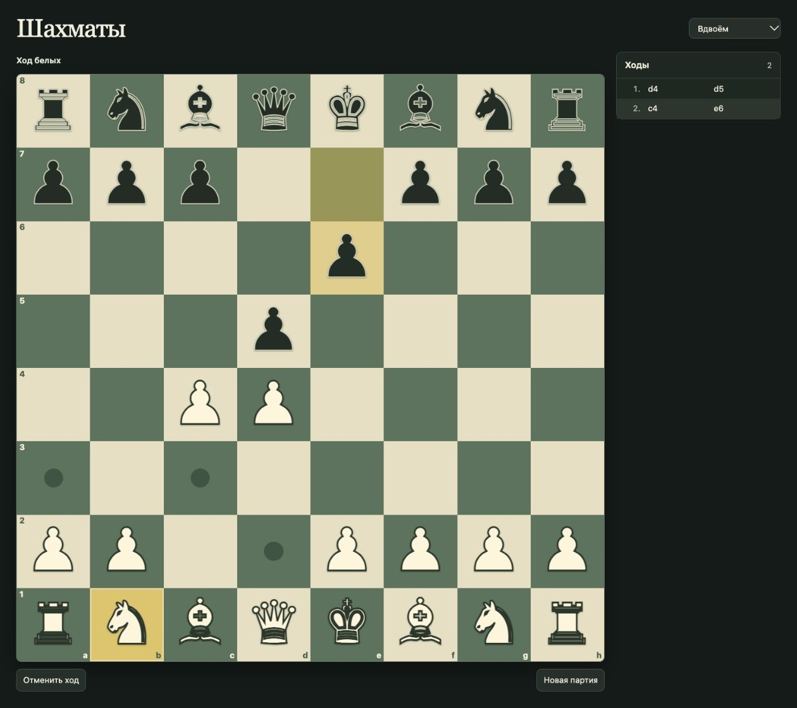

# Play Chess

Шахматный навык для Codex и других агентов с поддержкой Agent Skills. В настольном ChatGPT доска открывается рядом с чатом. Можно сыграть с Codex или переключиться на встроенного соперника.

## Установка

Для установки одной командой нужен Node.js с npm. Для запуска доски из агента нужен Python 3.

**Codex**

```sh
npx skills add tikhonandrey/play-chess --skill play-chess -a codex -g
```

**Claude Code**

```sh
npx skills add tikhonandrey/play-chess --skill play-chess -a claude-code -g
```

Флаг `-g` делает навык доступным во всех проектах. Для установки в текущий проект уберите его. Для другого агента укажите его имя после `-a`, например `cursor`. [Список агентов в Vercel Skills](https://github.com/vercel-labs/skills/blob/main/docs/agents.md).

<details>
<summary>Установка в Codex через Git</summary>

```sh
git clone https://github.com/tikhonandrey/play-chess.git ~/.agents/skills/play-chess
```

Codex ищет навыки в `~/.agents/skills`. Если навык не появился, перезапустите приложение. [Документация Codex о навыках](https://learn.chatgpt.com/docs/build-skills).

</details>

## Как играть в настольном ChatGPT

1. Выберите **Codex** в переключателе настольного ChatGPT и откройте локальный чат (**Local** или **This computer**). [Режимы Codex](https://learn.chatgpt.com/docs/environments/modes).
2. Напишите **«Давай сыграем в шахматы»**. Для явного вызова можно написать **`$play-chess` Давай сыграем в шахматы**.
3. На панели справа появится доска в режиме **Вдвоём**. Вы играете белыми. Нажмите на фигуру, затем на подсвеченную клетку. Ходы записываются в панели **Ходы**.
4. Пока Codex следит за доской, он отвечает ходом прямо на ней. Можно попросить короткие подколы по ходу партии. Примерно через две минуты без ходов Codex приостанавливает наблюдение. Напишите **«Продолжим партию»**, чтобы он вернулся к той же доске.



**Отменить ход** в режиме **Вдвоём** возвращает один ход одной стороны. После ответа Codex нажмите дважды, чтобы отменить оба хода и сходить заново. **Новая партия** сбрасывает доску. Для одиночной игры выберите **С компьютером**. [Как открыть чат и браузер рядом](https://learn.chatgpt.com/docs/browser?surface=app#arrange-tabs-and-chat).

## Что нужно для интерактивной игры

Чтобы агент отвечал сразу после вашего хода, ему нужны три возможности.

- **Доступ к общей вкладке.** Вы видите ту же доску, которой управляет агент. Локальный адрес доски должен открываться во встроенном или подключённом браузере.
- **Чтение и клики.** Браузерный инструмент агента читает очередь хода (`#turn`) и историю (`#moves`), а затем нажимает нужные клетки.
- **Ожидание в рамках одного ответа.** Харнес должен позволять инструменту ждать изменения на странице с тайм-аутом или повторно читать страницу. После завершения ответа наблюдение возобновится с новым сообщением в чате.

**В Codex** откройте локальный чат настольного ChatGPT со встроенным браузером. В проверенной партии агент использовал `mcp__cua_repl.js`. Вызов Playwright `locator.waitFor()` ждал смены очереди, а `locator.click()` делал ход. В другом харнесе подойдёт аналогичный инструмент, если он работает с той же вкладкой, где вы играете.

**Если агент работает с доской по запросу**, сделайте ход и напишите «твой ход». Если общего браузера нет, можно отправлять ходы по нотации в чат или играть со встроенным соперником.

## Доска в отдельном браузере

Чтобы открыть доску вручную, запустите скрипт из папки репозитория или установленного навыка.

```sh
python3 scripts/serve.py
```

Если Python 3 у вас запускается командой `python`, используйте её. Откройте адрес, который напечатает скрипт. Для игры вдвоём выберите **Вдвоём**. Позиция сохраняется в том же браузере по тому же локальному адресу. Если агент работает на удалённой машине, скачайте [chess.html](assets/chess.html) и откройте файл на своём компьютере.

Точка входа для агентов — [SKILL.md](SKILL.md).
